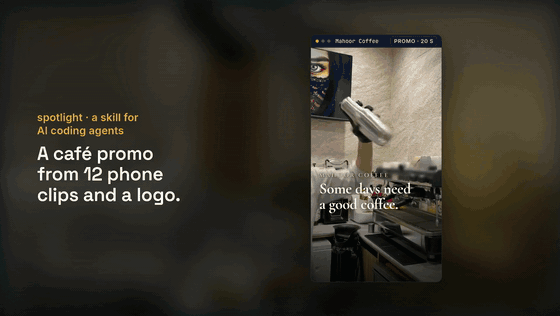
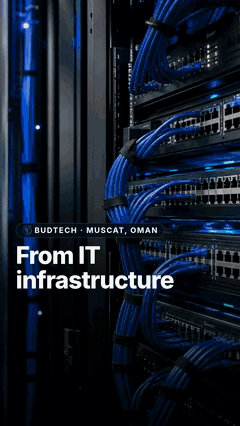
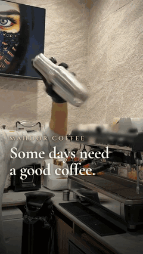

# spotlight: short videos made by your AI coding agent

**spotlight is a free, open-source Agent Skill that turns a website, a folder of phone clips or a spreadsheet into a finished short video. You get a launch video, a promo reel or a narrated explainer, made by Claude Code, Codex CLI, Hermes Agent or any AI agent that reads `SKILL.md`.** Each video comes with music, captions in your language (Arabic and Persian included), a poster and a caption ready to post. Every one is measured and reviewed by a second AI agent before you see it.

[](examples/brag/video.mp4)

*Every clip in this video was made with spotlight, and so was the video itself. [Watch it with sound](examples/brag/video.mp4), or see [the square cut for LinkedIn](examples/brag/video-square.mp4).*

[](https://aiagentslisting.com/mcp/spotlight)

## Example videos made with spotlight

| Video | Made from | Mode |
|---|---|---|
| [BudTech launch video](examples/website/video.mp4) | the live website budtech.om | brag, vertical, 20 s |
| [Mahoor Coffee promo](examples/promo/video.mp4) ([Persian cut](examples/promo/video-fa.mp4)) | twelve phone clips and a logo | promo, vertical, 20 s |
| [Why spotlight checks its own videos](examples/explain/video.mp4) | check results and a critic report | explain, landscape, 60 s, narrated |
| [spotlight's own launch video](examples/brag/video.mp4) ([square](examples/brag/video-square.mp4)) | the other examples | brag, landscape and square, 24 s |

Each folder holds the video, its poster, the plan, `sources.md` (where every line on screen came from) and the critic's reports.

## What can spotlight make?

spotlight has three modes. You give it whatever you have, and the agent picks the mode, works out the story, picks the shots and writes the words.

| Mode | You give it | You get |
|---|---|---|
| **brag** | a website or a code project | a 15 to 25 s launch video built from the real product |
| **promo** | your own footage and photos, plus a line about the business | a 15 to 30 s promo reel where your material is the star |
| **explain** | a topic, a CSV or JSON file, maybe a site or footage | a 60 to 180 s explainer, which is a presentation as a video |

## How do I turn my website into a launch video?

Give the agent the live site, or run it inside the project:

```text
/spotlight https://your-app.com
/spotlight . --tone yc-parody
```

spotlight captures the site's copy, colours, fonts, logo and pages, finds the two or three moments where the product does its job, and builds the video from your real UI. Tones include `polished`, `cinematic`, `deadpan`, `chaotic` and `yc-parody`.

[](examples/website/video.mp4)

*A 20-second launch video made from the live site of [BudTech](https://budtech.om), an IT services company in Muscat, Oman, owned by spotlight's author. Every word on screen is the site's own, and the video switches the real site from English to Arabic through its language menu. [Watch it with sound](examples/website/video.mp4). Three critic rounds took the video from a dark, slow first cut to SHIP ([plan](examples/website/plan.md), [reports](examples/website/critics)).*

## How do I turn phone videos into a promo reel?

Point it at the folder and say what the business is:

```text
/spotlight ~/Videos/opening-night "Grand opening Friday at 7. First coffee is on us."
```

It sorts the clips, drops the shaky and dark ones, opens on the strongest moving shot and ends on your call to action. The captions sell a feeling in the brand's voice instead of describing what's already on screen.

[](examples/promo/video.mp4)

*A 20-second promo for [Mahoor Coffee](https://www.instagram.com/mahoor_hills/), cut from twelve of the café's own phone clips and its logo. Its captions are one thread about a good day with a good coffee. [Watch it with sound](examples/promo/video.mp4), or see [the Persian cut](examples/promo/video-fa.mp4). Three critic rounds caught the espresso machine maker's slogan, another café's branded cup and captions hidden under Instagram's buttons ([plan](examples/promo/plan.md), [reports](examples/promo/critics)). The footage and logo belong to the café and are used with permission.*

## How do I make an explainer video from data?

Give it the topic and the file:

```text
/spotlight "why we moved support to async" tickets.csv --mode explain --voice
```

You get a landscape explainer: a hook question, three to five sections that each make one claim and show the evidence, then a takeaway. Charts are drawn from your data, and every number on screen is the exact string in your file. `--voice` adds narration read by a local text-to-speech model.

[](examples/explain/video.mp4)

*A 60-second narrated explainer about spotlight's own quality check, built from real check results and a real critic report. An agent that knew spotlight only from its `SKILL.md` started it, then it went through two more critic rounds. [Watch it with sound](examples/explain/video.mp4). Its [sources](examples/explain/sources.md) trace every line on screen, and its [plan](examples/explain/plan.md) has the command and the three critic rounds ([reports](examples/explain/critics)).*

## Can spotlight make videos in Arabic, Persian or other languages?

Yes. Pass `--lang fa`, `--lang ar`, `--lang de` or any other language code, or let it take the language from your brief or your site. Persian and Arabic letters stay joined and run right to left, and numbers and Latin names inside them keep their order. Narration is available in English, Persian, Italian, Dutch and Ukrainian.

## Can I get vertical, square and landscape versions?

Yes. Promos and launch videos default to vertical 1080x1920 for Reels, Shorts and TikTok, and explainers to landscape 1920x1080. Pass `--format square` or `--format landscape`, or ask "make it square for LinkedIn". It reuses the work folder, so it re-renders instead of starting over.

## What do I get?

A `spotlight-output/` folder, timestamped if one already exists:

- `video.mp4`: H.264 at 30 fps and −14 LUFS, with the poster embedded as cover art
- `music-only.mp4`: the same video over the music alone (when the mix has effects or narration), for adding your own voice-over
- `poster.jpg`: the strongest settled frame
- `caption.txt`: a caption ready to post, in the video's language
- `plan.md`: the angle, the shot list and the music cues
- `sources.md`: every line of on-screen text and every number, next to where it came from
- `work/`: everything needed for a re-cut

## How does spotlight make a video?

The agent writes a brief and a shot plan, then builds the video as a web page where every frame is a function of time, and Chromium captures it frame by frame. Bundled scripts do the fiddly parts:

- `footage.py` turns any photo or clip into upright, frame-exact material. It copes with HEIC, HDR, rotated phone video and odd frame rates, and it encodes the final video.
- `site.mjs` captures a website's copy, colours, fonts, logo, screens and a full-page image, within a hard time limit.
- `capture.mjs` renders frames in parallel, and the result matches a single-threaded render pixel for pixel.
- The render kit draws charts (bar, line, donut and a counting number) from your data, diagrams whose lines draw in, a dotted globe with routes between real places, and an extruded 3D logo.
- `mix.py` levels the music, ducks it under the narration and sets each sound effect so it's heard without ever peaking over the music.
- `voice.py` reads narration aloud with [Piper](https://github.com/OHF-Voice/piper1-gpl), locally, using only voices whose licences allow commercial use.

## How does spotlight check a video before you see it?

Twice over: once by measurement, once by a critic.

- **Measured:** `footage.py check` fails a video whose loudness misses −14 LUFS, whose true peak is over −1.5 dBTP or that is missing a frame. It flags any stretch outside the end card that sits still for more than 0.6 s, and the agent fixes every one. It also writes a contact sheet with timestamps.
- **Critiqued:** a fresh AI agent that didn't build the video watches the frames, reads the measurements and writes down what's wrong. The builder fixes it, and another fresh agent confirms. This runs for up to three rounds.

Every fact, price and number on screen comes from something you gave it, and `sources.md` lists where. AI images are optional, appear only as clearly illustrative backgrounds, and the caption says when one is used.

## Which AI agents can use spotlight?

Any agent that reads `SKILL.md` and can run shell commands. Codex CLI and Hermes Agent were each tested end to end on a narrated explainer with a chart and a 3D globe, and Claude Code made every example here. [Using spotlight with other agents](docs/other-agents.md) explains how to install it for each one and how to run it headless.

## How do I install spotlight?

For Claude Code:

```bash
claude plugin marketplace add AmirSbss/spotlight
claude plugin install spotlight@spotlight
```

For Codex, Hermes and other agents, the [skills CLI](https://github.com/vercel-labs/skills) installs it:

```bash
npx skills add https://github.com/AmirSbss/spotlight --skill spotlight
```

Then check that the machine has what it needs:

```bash
bash skills/spotlight/scripts/doctor.sh
```

You need ffmpeg 4.4 or newer with the zscale filter, ImageMagick 6 or 7, Python 3.8+, Node 18+, Chromium or Chrome, and [uv](https://docs.astral.sh/uv/). Piper is optional, for narration (`uv tool install --python 3.12 "piper-tts>=1.3"`). So is [gpt-image-bridge](https://github.com/oakplank/gpt-image-bridge), for the odd AI illustration.

## Is the music free to use in my videos?

Yes, including commercially. Most of the bundled music is by Sascha Ende at [ende.app](https://ende.app), licensed CC BY 4.0. Credit "Music by Sascha Ende at ende.app" (spotlight puts it in `sources.md` for you), and don't register the music with YouTube Content ID. One track and all 18 sound effects are CC0. Your own track always wins: pass `--music <file>`. [The music licences](skills/spotlight/assets/music/LICENSES.md) list every file's source.

## Is my footage private?

Yes. Your footage, renders and plans stay on your machine, and nothing is uploaded. The one exception is the prompt for an optional AI illustration, and `--no-ai` turns that off too.

## Project status

The three modes, website capture, the measurements and critic loop, sound (music, levelled effects and local narration) and visuals (charts, diagrams, a routes globe and an extruded logo) are done. One finished example per mode is in [examples](examples). The design and the plans live in [docs/superpowers](docs/superpowers).

## Tests

```bash
python3 tests/test_footage.py && python3 tests/test_check.py && python3 tests/test_docs.py && python3 tests/test_assets.py
uv run --project skills/spotlight/scripts python tests/test_mix.py
bash tests/test_capture.sh && bash tests/test_kit.sh && bash tests/test_site.sh && bash tests/test_three.sh
bash tests/test_doctor.sh && bash tests/test_bridge_image.sh && bash tests/test_voice.sh
```

## Credits and license

spotlight is MIT-licensed. It is built on [brag](https://github.com/latent-spaces/brag) (MIT), and the critic loop and quality bar are adapted from [motion-video-kit](https://github.com/echris6/motion-video-kit) (MIT). [NOTICE.md](NOTICE.md) lists all third-party work, including the music, fonts and the footage in the examples.
